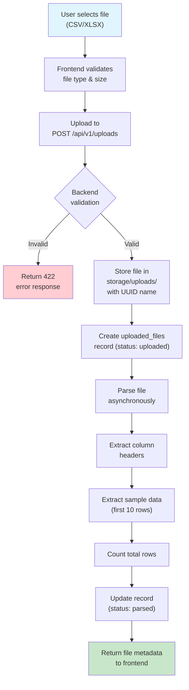
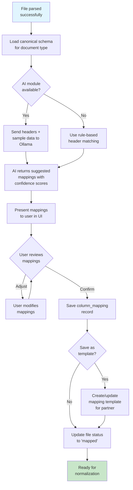
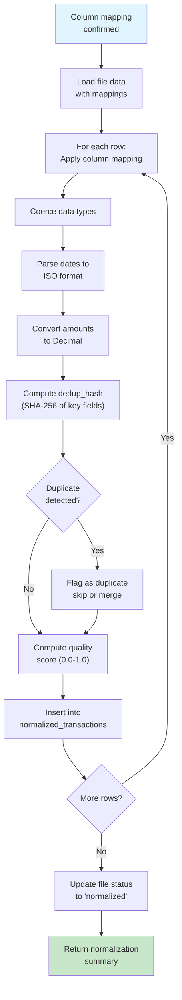
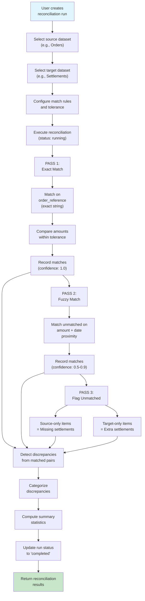
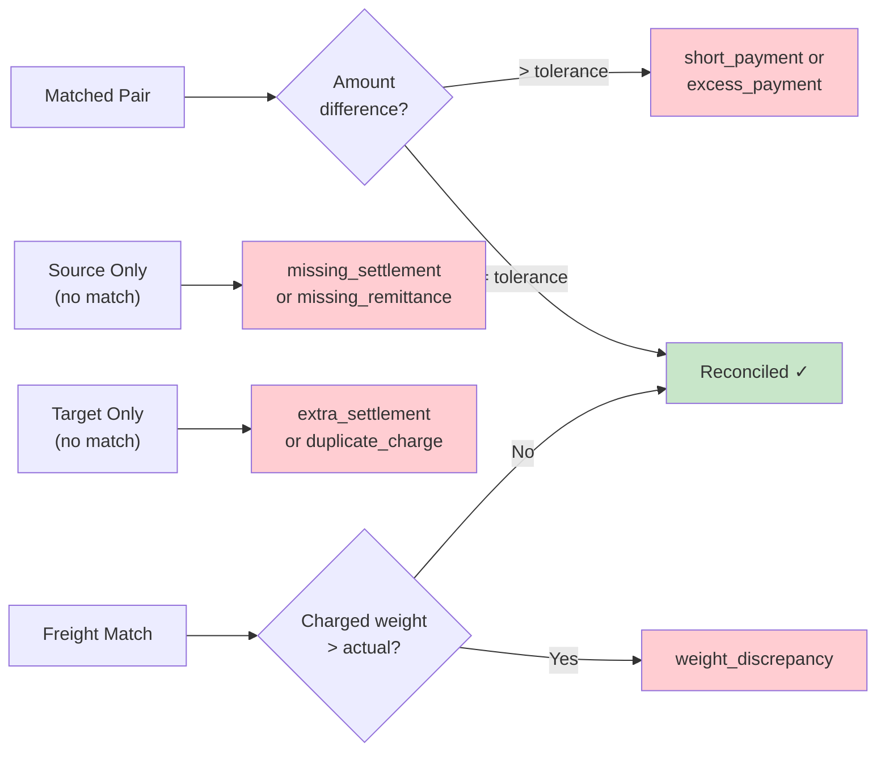
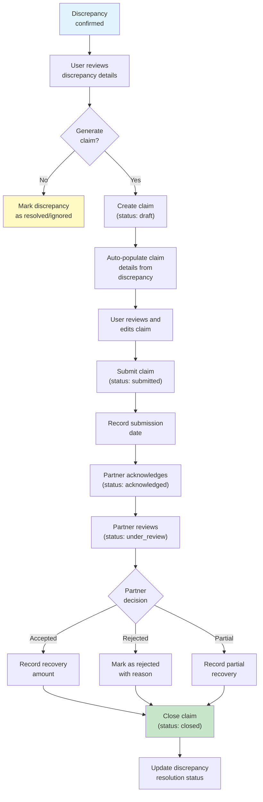
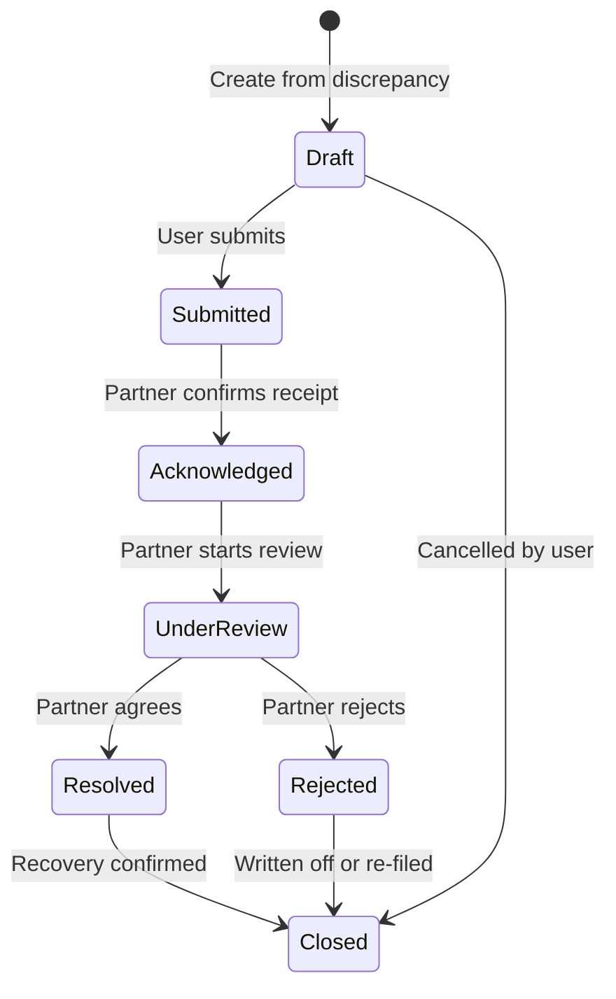
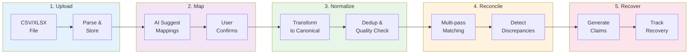

# ReconIQ — Data Flow Documentation

## 1. Overview

This document details the data flows through the ReconIQ platform, from file upload through reconciliation to claims generation.

---

## 2. File Upload Flow



### Flow Details

| Step | Component | Description |
|---|---|---|
| 1 | Frontend | User selects a file and chooses document type (orders, settlements, etc.) and partner |
| 2 | Frontend | Client-side validation: file extension (.csv, .xlsx), max size (50MB default) |
| 3 | API | Multipart form upload with metadata (document_type, partner) |
| 4 | Service | Server-side validation: MIME type check, size re-validation, malware scan (future) |
| 5 | Storage | File saved with UUID filename to prevent collisions and path traversal |
| 6 | Database | Upload record created with `status: uploaded` |
| 7 | Parser | CSV/Excel parser reads the file, handles encoding detection |
| 8-10 | Parser | Extract headers, sample rows, and row count |
| 11 | Database | Record updated to `status: parsed` with extracted metadata |
| 12 | API | Return parsed file info including headers and preview |

---

## 3. Column Mapping Flow



### Canonical Schema Fields

| Document Type | Required Fields | Optional Fields |
|---|---|---|
| **Orders** | order_reference, order_date, net_amount, status | sku, product_name, quantity, discount, payment_method |
| **Settlements** | order_reference, settlement_date, net_settlement | commission, shipping_fee, tcs, tds |
| **Freight** | order_reference, awb_number, total_freight | weight, charged_weight, zone, courier_partner |
| **COD Remittances** | order_reference, cod_amount, remitted_amount, status | utr_number, remittance_date |
| **Returns** | order_reference, return_date, return_status | refund_amount, refund_status, return_reason |

---

## 4. Normalization Flow



### Quality Score Calculation
The quality score reflects data completeness:
```
score = (filled_required_fields / total_required_fields) * 0.7
      + (filled_optional_fields / total_optional_fields) * 0.3
```

### Deduplication Hash
```python
dedup_hash = sha256(f"{order_reference}|{document_type}|{partner}|{transaction_date}|{net_amount}")
```

---

## 5. Reconciliation Flow



### Match Types

| Match Type | Confidence | Criteria |
|---|---|---|
| `exact` | 1.0 | Order reference matches exactly, amounts within tolerance |
| `fuzzy_high` | 0.8–0.9 | Order reference similar, amounts match, dates within 3 days |
| `fuzzy_low` | 0.5–0.7 | Amounts match, partner matches, dates within 7 days |
| `manual` | N/A | Flagged for human review |

### Discrepancy Detection Rules



---

## 6. Claims Flow



### Claim Lifecycle States



---

## 7. Complete End-to-End Flow


