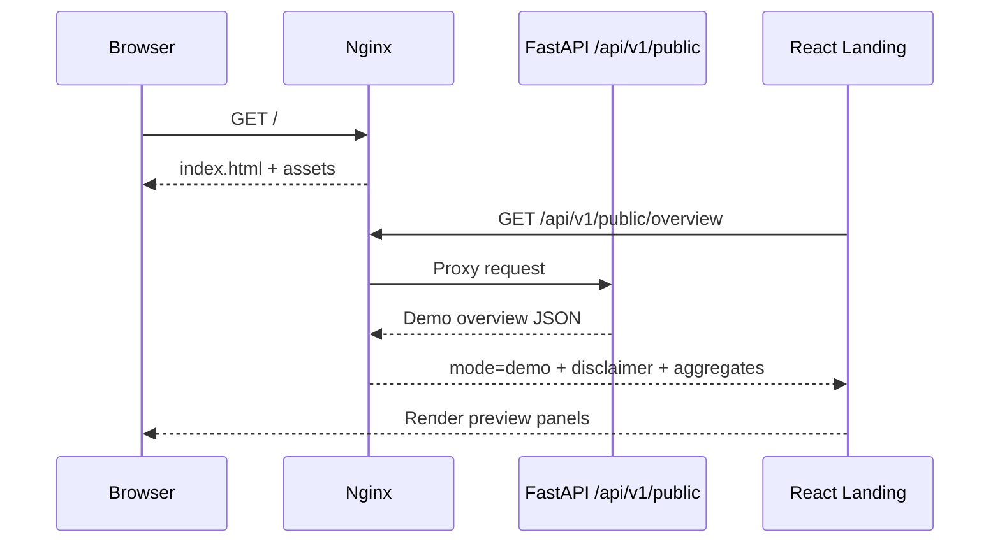
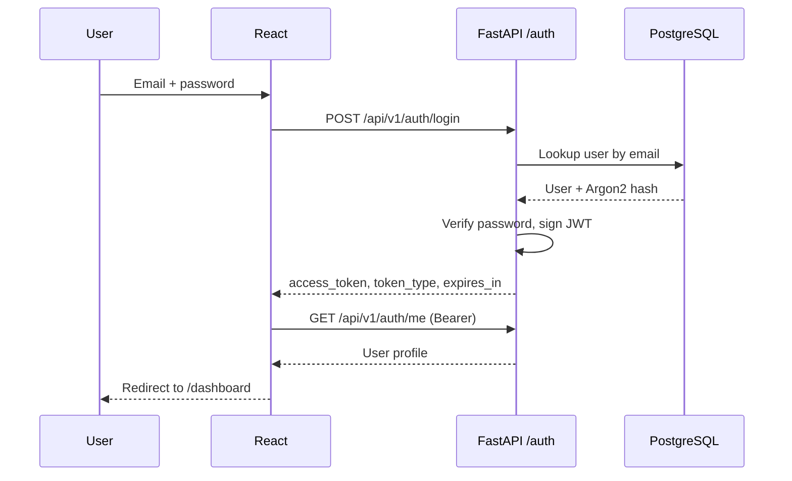
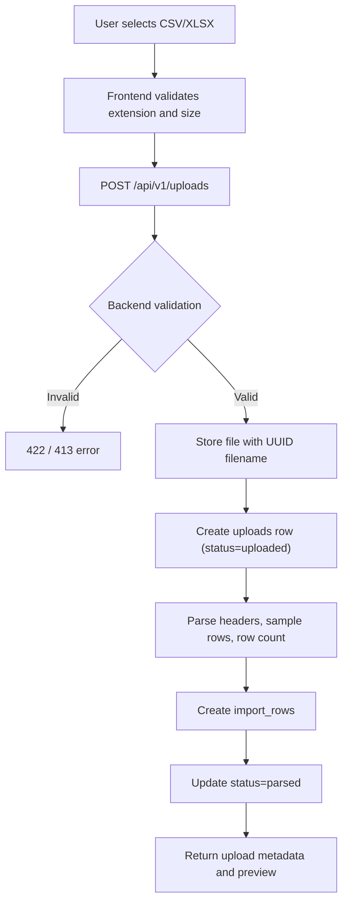
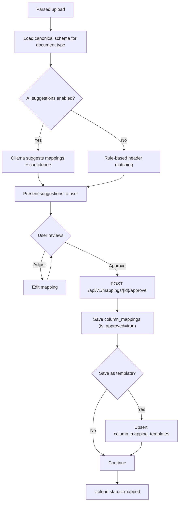
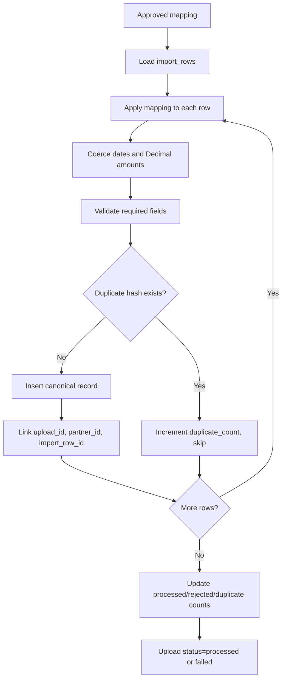
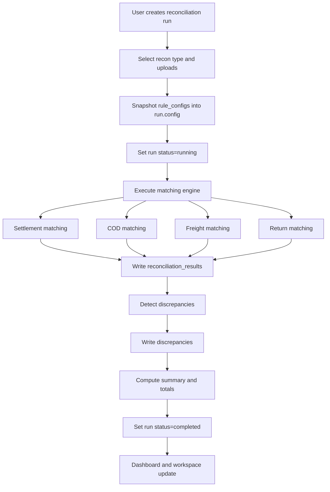
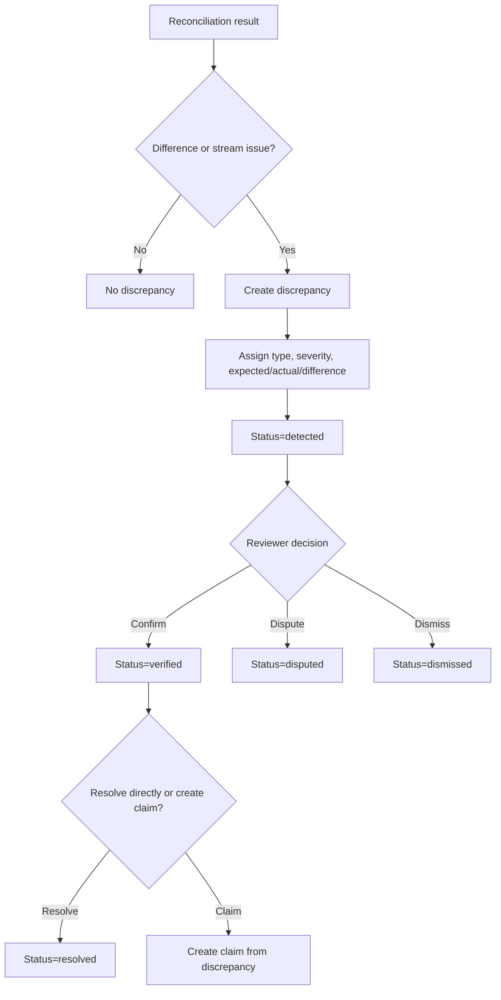
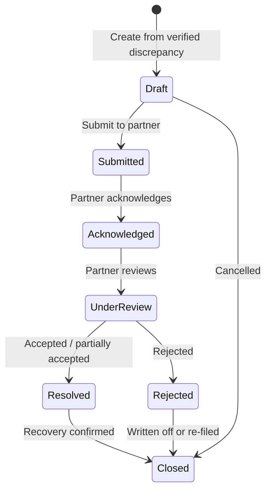

# ReconIQ - Data Flow Documentation

## 1. Overview

This document describes how data moves through ReconIQ:

1. Public landing-page demo data
2. Authentication
3. File upload and parsing
4. Column mapping and approval
5. Normalization into canonical financial records
6. Reconciliation and matching
7. Discrepancy detection
8. Claims and recovery

All tenant-owned flows are scoped by `org_id`. Monetary calculations use `Decimal` and PostgreSQL `NUMERIC`.

---

## 2. Public landing data flow

The public landing page is intentionally isolated from tenant data.



### Contract

`GET /api/v1/public/overview` returns:

- `mode: "demo"`
- `disclaimer`: explicitly states the values are not live customer data
- `generated_at`
- `overview`: total, matched, pending, matching rate, status
- `trend`: seven daily points
- `matching_breakdown`
- `settlement`: expected, actual, difference, status
- `discrepancies`: open, under review, resolved, categories
- `claims`: lifecycle counts and recovered amount

### Guarantees

- No authentication is required.
- No database session is used.
- No tenant, organization, user, email, settlement, or token fields are returned.
- Arithmetic is internally consistent; tests enforce it.
- The frontend never falls back to hardcoded business totals.
- If the endpoint fails, the landing page shows an unavailable state with a retry action.

---

## 3. Authentication flow



- Tokens are stored in browser local storage under `reconiq_token`.
- The shared Axios client attaches `Authorization: Bearer <token>`.
- A `401` response clears stored credentials and redirects to `/login`.
- The authenticated layout redirects unauthenticated users to `/login`.
- Login and registration redirect authenticated users to `/dashboard`.

---

## 4. File upload flow



### Details

| Step | Component | Behaviour |
|---|---|---|
| 1 | Frontend | Accepts `.csv` and `.xlsx`, checks `MAX_UPLOAD_SIZE_MB` |
| 2 | API | Re-validates type and size |
| 3 | Storage | Saves under `UPLOAD_DIR` with a UUID filename |
| 4 | Database | Creates an `uploads` row with checksum and metadata |
| 5 | Parser | Extracts headers, sample rows, and row count |
| 6 | Database | Creates `import_rows` for raw row storage |
| 7 | Database | Sets `status=parsed` |

Upload status lifecycle:

```text
uploaded -> parsed -> mapped -> processing -> processed
                                             \-> failed
```

---

## 5. Column mapping flow



### Rules

- AI suggestions are advisory and optional.
- A human must approve the mapping before normalization.
- The approved mapping is stored with version, approver, and timestamp.
- Templates are organization- and partner-scoped.

### Canonical fields

| Document type | Required fields | Optional fields |
|---|---|---|
| Orders | `order_reference`, `net_amount` | date, SKU, product, quantity, discount, payment method, customer location, status |
| Settlements | `order_reference`, `actual_received` | settlement date, commission, shipping fee, other fees, TCS, TDS |
| COD remittances | `order_reference`, `cod_amount`, `remitted_amount` | remittance date, UTR, status |
| Freight invoices | `order_reference`, `total_freight` | AWB, invoice date, zone, actual/charged weight, rate, COD charges |
| Returns | `order_reference`, `refund_amount` | return date, reason, return status, refund status/date |
| Warehouse scans | `order_reference`, `scan_date` | scan reference, AWB, scan type, status, location |

---

## 6. Normalization flow



Canonical tables:

- `orders`
- `settlements`
- `cod_remittances`
- `freight_records`
- `returns`
- `warehouse_scans`

Normalization records:

- `processed_count` - successfully inserted rows
- `rejected_count` - validation failures
- `duplicate_count` - rows skipped by duplicate hash
- `error_message` - fatal parsing/normalization detail

Deduplication uses a SHA-256 hash over key fields. The hash is stored on `orders.dedup_hash` and used to prevent duplicate imports.

---

## 7. Reconciliation flow



### Run types

- `settlement` - orders vs marketplace settlements
- `cod` - orders vs COD remittances
- `freight` - orders vs freight invoices and rate cards
- `return` - returns vs warehouse scans and refunds

### Match methods

| Method | Meaning |
|---|---|
| `exact` | Exact order/reference match |
| `composite` | Match on multiple fields |
| `fuzzy` | Similar reference/amount/date |
| `ai_assisted` | AI suggested candidate, human still reviews |
| `manual` | Human-created or human-confirmed match |

### Match statuses

- `matched`
- `partial`
- `unmatched`
- `review_pending`
- `confirmed`
- `rejected`

### Rule configuration

`rule_configs` stores organization-scoped or global defaults for:

- amount tolerance
- settlement due days
- COD due days
- late grace days
- return scan window
- RTO expected multiplier
- severity thresholds

The active values are copied into `reconciliation_runs.config` so historical runs remain explainable even after defaults change.

---

## 8. Discrepancy flow



### Severity

- `low`
- `medium`
- `high`
- `critical`

Thresholds are configurable through `rule_configs`.

### Discrepancy categories

Short payment, missing settlement, unpaid order, missing COD remittance, freight overcharge, incorrect freight weight, incorrect freight zone, return/refund mismatch, duplicate deduction, excess payment, and stream-specific categories such as `short_paid`, `unpaid_past_due`, `freight_overcharged`, `return_not_received`, and `settled_late`.

---

## 9. Claims flow



### Claim records

- `claims` stores reference, type, amount, recovered amount, status, notes, and lifecycle timestamps.
- `claim_evidence` stores an immutable snapshot of the discrepancy and supporting data.
- Recovery amounts are recorded as `Decimal`/`NUMERIC`.
- Claim actions are written to `audit_logs`.

---

## 10. End-to-end flow

```mermaid
flowchart LR
    subgraph Ingest["1. Ingest"]
        A["CSV/XLSX"] --> B["Parse"]
    end

    subgraph Map["2. Map"]
        B --> C["Suggest mappings"]
        C --> D["Human approves"]
    end

    subgraph Normalize["3. Normalize"]
        D --> E["Canonical records"]
        E --> F["Deduplicate and count"]
    end

    subgraph Reconcile["4. Reconcile"]
        F --> G["Run matching"]
        G --> H["Detect discrepancies"]
    end

    subgraph Recover["5. Recover"]
        H --> I["Create claims"]
        I --> J["Track recovery"]
    end

    style Ingest fill:#e3f2fd
    style Map fill:#f3e5f5
    style Normalize fill:#e8f5e9
    style Reconcile fill:#fff3e0
    style Recover fill:#fce4ec
```



---

## 11. Failure and retry behaviour

| Failure | Behaviour |
|---|---|
| Invalid file type/size | API returns `413` or `422`; no upload row |
| Parse failure | Upload status `failed`, error message stored |
| Mapping not approved | Normalization cannot start |
| Row validation failure | Row rejected; `rejected_count` increments |
| Duplicate row | Skipped; `duplicate_count` increments |
| Matching failure | Run status `failed`; error captured |
| Public endpoint unavailable | Landing shows unavailable state and retry button |
| Expired/invalid JWT | API returns `401`; frontend clears credentials and redirects to `/login` |
| Database unavailable | `/ready` reports not ready; containers remain unhealthy |

---

## 12. Data boundaries

- Public landing data is aggregate demo data only.
- Tenant-owned endpoints require a bearer token and filter by `org_id`.
- AI outputs are advisory and never mutate financial records.
- Uploaded files are stored outside the web root.
- Audit logs record sensitive workflow actions.
- Claim evidence is append-oriented and retained for dispute history.
