# ReconIQ — Database Design

## 1. Overview

ReconIQ uses PostgreSQL 16 as its primary datastore. The schema is designed for financial accuracy, multi-tenant isolation, and efficient reconciliation queries.

### Design Principles
- **UUID primary keys** on all tables (no sequential IDs exposed)
- **NUMERIC(15, 2)** for all monetary columns — never `FLOAT` or `DOUBLE`
- **Timestamp tracking** (`created_at`, `updated_at`) on every table
- **Organization scoping** (`org_id`) for multi-tenant data isolation
- **Soft deletes** where business logic requires audit trails
- **JSONB** for flexible metadata (column mappings, file headers, etc.)

---

## 2. Entity-Relationship Diagram

```mermaid
erDiagram
    users ||--o{ organizations : "owns"
    users }o--|| organizations : "belongs_to"
    organizations ||--o{ uploaded_files : "has"
    organizations ||--o{ column_mapping_templates : "has"
    organizations ||--o{ reconciliation_runs : "has"

    uploaded_files ||--o{ column_mappings : "has"
    uploaded_files ||--o{ normalized_transactions : "produces"

    column_mapping_templates ||--o{ column_mappings : "based_on"

    reconciliation_runs ||--o{ match_results : "contains"
    reconciliation_runs ||--o{ discrepancies : "generates"

    match_results }o--|| normalized_transactions : "source_txn"
    match_results }o--|| normalized_transactions : "target_txn"

    discrepancies ||--o{ claims : "generates"

    users {
        uuid id PK
        string email UK
        string full_name
        string hashed_password
        string role
        uuid org_id FK
        boolean is_active
        timestamp created_at
        timestamp updated_at
    }

    organizations {
        uuid id PK
        string name
        string slug UK
        uuid owner_id FK
        jsonb settings
        boolean is_active
        timestamp created_at
        timestamp updated_at
    }

    uploaded_files {
        uuid id PK
        uuid org_id FK
        uuid uploaded_by FK
        string original_filename
        string stored_filename
        string file_type
        string document_type
        string partner
        bigint file_size
        integer row_count
        jsonb column_headers
        jsonb sample_data
        string status
        string error_message
        timestamp created_at
        timestamp updated_at
    }

    column_mappings {
        uuid id PK
        uuid file_id FK
        uuid template_id FK
        jsonb mappings
        boolean is_confirmed
        uuid confirmed_by FK
        timestamp confirmed_at
        timestamp created_at
        timestamp updated_at
    }

    column_mapping_templates {
        uuid id PK
        uuid org_id FK
        string name
        string partner
        string document_type
        jsonb mappings
        boolean is_default
        timestamp created_at
        timestamp updated_at
    }

    normalized_transactions {
        uuid id PK
        uuid org_id FK
        uuid file_id FK
        string document_type
        string partner
        string order_reference
        string transaction_type
        date transaction_date
        string sku
        string product_name
        integer quantity
        numeric gross_amount
        numeric discount
        numeric net_amount
        numeric commission
        numeric shipping_fee
        numeric tcs
        numeric tds
        numeric other_deductions
        numeric net_settlement
        string payment_method
        string status
        jsonb raw_data
        numeric quality_score
        string dedup_hash
        timestamp created_at
    }

    reconciliation_runs {
        uuid id PK
        uuid org_id FK
        uuid created_by FK
        string name
        string recon_type
        uuid source_file_id FK
        uuid target_file_id FK
        string status
        jsonb config
        jsonb summary
        integer total_source
        integer total_target
        integer matched_count
        integer unmatched_count
        integer discrepancy_count
        numeric total_expected
        numeric total_received
        numeric total_discrepancy
        timestamp started_at
        timestamp completed_at
        timestamp created_at
        timestamp updated_at
    }

    match_results {
        uuid id PK
        uuid run_id FK
        uuid source_txn_id FK
        uuid target_txn_id FK
        string match_type
        numeric confidence_score
        numeric amount_difference
        string status
        jsonb details
        timestamp created_at
    }

    discrepancies {
        uuid id PK
        uuid org_id FK
        uuid run_id FK
        uuid match_result_id FK
        string discrepancy_type
        string category
        string severity
        string order_reference
        string partner
        numeric expected_amount
        numeric actual_amount
        numeric difference_amount
        string status
        string resolution
        uuid resolved_by FK
        timestamp resolved_at
        jsonb metadata
        timestamp created_at
        timestamp updated_at
    }

    claims {
        uuid id PK
        uuid org_id FK
        uuid discrepancy_id FK
        string claim_reference
        string partner
        string claim_type
        numeric claim_amount
        numeric recovered_amount
        string status
        string notes
        uuid created_by FK
        uuid assigned_to FK
        timestamp submitted_at
        timestamp acknowledged_at
        timestamp resolved_at
        timestamp closed_at
        jsonb metadata
        timestamp created_at
        timestamp updated_at
    }
```



---

## 3. Table Descriptions

### 3.1 `users`
Stores user accounts. Passwords are hashed with Argon2id. Each user belongs to one organization and has a role that controls access.

| Column | Type | Constraints | Description |
|---|---|---|---|
| `id` | `UUID` | PK, default gen | Unique user identifier |
| `email` | `VARCHAR(255)` | UNIQUE, NOT NULL | Login email |
| `full_name` | `VARCHAR(255)` | NOT NULL | Display name |
| `hashed_password` | `VARCHAR(255)` | NOT NULL | Argon2id hash |
| `role` | `VARCHAR(50)` | NOT NULL | `owner`, `admin`, `member`, `viewer` |
| `org_id` | `UUID` | FK → organizations | Owning organization |
| `is_active` | `BOOLEAN` | DEFAULT TRUE | Soft active flag |
| `created_at` | `TIMESTAMPTZ` | NOT NULL | Record creation time |
| `updated_at` | `TIMESTAMPTZ` | NOT NULL | Last update time |

### 3.2 `organizations`
Multi-tenant isolation boundary. All business data is scoped to an organization.

| Column | Type | Constraints | Description |
|---|---|---|---|
| `id` | `UUID` | PK | Unique org identifier |
| `name` | `VARCHAR(255)` | NOT NULL | Organization name |
| `slug` | `VARCHAR(255)` | UNIQUE, NOT NULL | URL-safe identifier |
| `owner_id` | `UUID` | FK → users | Organization creator |
| `settings` | `JSONB` | DEFAULT '{}' | Org-level settings |
| `is_active` | `BOOLEAN` | DEFAULT TRUE | Active flag |
| `created_at` | `TIMESTAMPTZ` | NOT NULL | Creation time |
| `updated_at` | `TIMESTAMPTZ` | NOT NULL | Last update time |

### 3.3 `uploaded_files`
Tracks every file uploaded to the system with parsing status and metadata.

| Column | Type | Constraints | Description |
|---|---|---|---|
| `id` | `UUID` | PK | File identifier |
| `org_id` | `UUID` | FK → organizations, NOT NULL | Owning org |
| `uploaded_by` | `UUID` | FK → users, NOT NULL | Uploader |
| `original_filename` | `VARCHAR(500)` | NOT NULL | Original file name |
| `stored_filename` | `VARCHAR(500)` | NOT NULL | UUID-based stored name |
| `file_type` | `VARCHAR(10)` | NOT NULL | `csv`, `xlsx` |
| `document_type` | `VARCHAR(50)` | NOT NULL | `orders`, `settlements`, `freight`, `cod_remittances`, `returns` |
| `partner` | `VARCHAR(100)` | | Marketplace partner name |
| `file_size` | `BIGINT` | NOT NULL | File size in bytes |
| `row_count` | `INTEGER` | | Number of data rows |
| `column_headers` | `JSONB` | | Extracted column headers |
| `sample_data` | `JSONB` | | First 10 rows as preview |
| `status` | `VARCHAR(20)` | NOT NULL | `uploaded`, `parsing`, `parsed`, `mapped`, `normalized`, `failed` |
| `error_message` | `TEXT` | | Error details if failed |
| `created_at` | `TIMESTAMPTZ` | NOT NULL | Upload time |
| `updated_at` | `TIMESTAMPTZ` | NOT NULL | Last update time |

### 3.4 `column_mappings`
Per-file column mapping configuration, linking uploaded columns to canonical fields.

### 3.5 `column_mapping_templates`
Reusable mapping templates per partner and document type. Saves time for repeated uploads.

### 3.6 `normalized_transactions`
The canonical transaction store. All uploaded data is transformed into this unified schema regardless of source format.

Key fields:
- `document_type`: Distinguishes orders, settlements, freight, COD, returns
- `dedup_hash`: SHA-256 hash of key fields for deduplication
- `quality_score`: 0.0–1.0 score indicating data completeness
- `raw_data`: Original row preserved as JSONB for audit

### 3.7 `reconciliation_runs`
Metadata for each reconciliation execution, including configuration, status, and summary statistics.

### 3.8 `match_results`
Individual match outcomes linking a source transaction to a target transaction with confidence scores.

### 3.9 `discrepancies`
Financial discrepancies detected during reconciliation, categorized by type and severity.

| Discrepancy Types | Description |
|---|---|
| `short_payment` | Settlement amount less than expected |
| `excess_payment` | Settlement amount more than expected |
| `missing_settlement` | Order has no corresponding settlement |
| `duplicate_settlement` | Multiple settlements for one order |
| `commission_overcharge` | Commission higher than agreed rate |
| `weight_discrepancy` | Freight charged weight exceeds actual |
| `cod_short_remittance` | COD remitted amount less than collected |
| `missing_return_refund` | Return processed but refund not received |

### 3.10 `claims`
Claims generated from confirmed discrepancies, tracking the recovery lifecycle.

| Claim Statuses | Description |
|---|---|
| `draft` | Claim created, not yet submitted |
| `submitted` | Submitted to partner |
| `acknowledged` | Partner acknowledged receipt |
| `under_review` | Partner reviewing the claim |
| `resolved` | Partner agreed to resolution |
| `rejected` | Partner rejected the claim |
| `closed` | Claim closed (recovered or written off) |

---

## 4. Key Relationships

### Primary Relationships
1. **User ↔ Organization**: Many-to-one. Every user belongs to exactly one organization.
2. **Organization ↔ Uploaded Files**: One-to-many. Files are scoped to an org.
3. **Uploaded File ↔ Normalized Transactions**: One-to-many. Each file produces many transactions.
4. **Reconciliation Run ↔ Match Results**: One-to-many. Each run produces match outcomes.
5. **Match Result → Discrepancy**: One-to-one/zero. A mismatch may generate a discrepancy.
6. **Discrepancy → Claim**: One-to-one/zero. A confirmed discrepancy may generate a claim.

### Cross-References
- `match_results.source_txn_id` and `match_results.target_txn_id` both reference `normalized_transactions.id`
- `reconciliation_runs.source_file_id` and `target_file_id` both reference `uploaded_files.id`

---

## 5. Indexing Strategy

### Primary Indexes (automatic)
All primary keys have implicit unique B-tree indexes.

### Unique Indexes
- `users.email` — login lookup
- `organizations.slug` — URL routing
- `normalized_transactions.dedup_hash` — deduplication

### Foreign Key Indexes
B-tree indexes on all foreign key columns for join performance:
- `uploaded_files.org_id`
- `uploaded_files.uploaded_by`
- `normalized_transactions.org_id`
- `normalized_transactions.file_id`
- `reconciliation_runs.org_id`
- `match_results.run_id`
- `discrepancies.org_id`
- `discrepancies.run_id`
- `claims.org_id`
- `claims.discrepancy_id`

### Query-Optimized Indexes
```sql
-- Fast order reference lookups across transaction types
CREATE INDEX ix_normalized_txn_order_ref
    ON normalized_transactions (order_reference);

-- Partner + document type filtering
CREATE INDEX ix_normalized_txn_partner_doctype
    ON normalized_transactions (partner, document_type);

-- Reconciliation status filtering
CREATE INDEX ix_recon_runs_status
    ON reconciliation_runs (org_id, status);

-- Discrepancy dashboard queries
CREATE INDEX ix_discrepancies_status_type
    ON discrepancies (org_id, status, discrepancy_type);

-- Claims by partner and status
CREATE INDEX ix_claims_partner_status
    ON claims (org_id, partner, status);

-- Date range queries on transactions
CREATE INDEX ix_normalized_txn_date
    ON normalized_transactions (transaction_date);
```

### GIN Indexes (JSONB)
```sql
-- Full-text search within raw transaction data
CREATE INDEX ix_normalized_txn_raw_data
    ON normalized_transactions USING GIN (raw_data);

-- Column mapping lookups
CREATE INDEX ix_column_mappings_mappings
    ON column_mappings USING GIN (mappings);
```

---

## 6. Financial Data Handling

### Column Types
All monetary columns use `NUMERIC(15, 2)`:
- **15 digits total**, **2 decimal places**
- Supports values up to ₹9,999,999,999,999.99 (sufficient for any Indian e-commerce scale)
- Exact decimal arithmetic — no floating-point rounding errors

### Python-Side Handling
```python
from decimal import Decimal, ROUND_HALF_UP

# All monetary values are Decimal in Python
amount = Decimal("1299.99")
commission = amount * Decimal("0.15")
commission = commission.quantize(Decimal("0.01"), rounding=ROUND_HALF_UP)
```

### SQLAlchemy Column Definition
```python
from sqlalchemy.orm import mapped_column, Mapped
from sqlalchemy import Numeric

class NormalizedTransaction(Base):
    gross_amount: Mapped[Decimal] = mapped_column(
        Numeric(15, 2), nullable=False
    )
    net_amount: Mapped[Decimal] = mapped_column(
        Numeric(15, 2), nullable=False
    )
```

### Pydantic Schema Validation
```python
from pydantic import BaseModel, Field
from decimal import Decimal

class TransactionSchema(BaseModel):
    gross_amount: Decimal = Field(..., max_digits=15, decimal_places=2)
    net_amount: Decimal = Field(..., max_digits=15, decimal_places=2)

    model_config = {"json_encoders": {Decimal: str}}
```

### Aggregation Queries
```sql
-- Always use SUM with NUMERIC — never cast to float
SELECT
    partner,
    SUM(expected_amount) AS total_expected,
    SUM(actual_amount) AS total_actual,
    SUM(difference_amount) AS total_discrepancy
FROM discrepancies
WHERE org_id = :org_id
GROUP BY partner;
```
