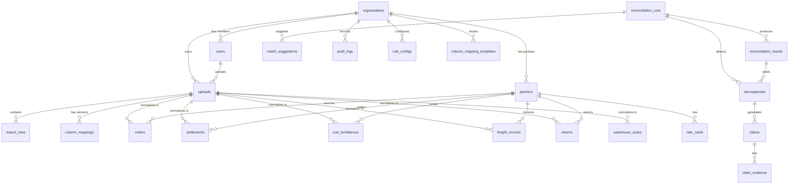

# ReconIQ - Database Design

## 1. Overview

ReconIQ uses PostgreSQL 16 as its system of record. The schema is designed for financial accuracy, multi-tenant isolation, and efficient reconciliation queries.

### Design principles

- **UUID primary keys** on every table.
- **`NUMERIC(15, 2)`** for monetary amounts, never `FLOAT` or `DOUBLE`.
- **`org_id`** on every tenant-owned table.
- **Timestamps** (`created_at`, `updated_at`) on every table.
- **JSONB** for raw rows, mappings, summaries, evidence snapshots, and flexible metadata.
- **Explicit enums** for workflow statuses and document types.
- **Audit trail** through `audit_logs` and immutable claim evidence.

All tables are created and evolved by Alembic migrations in `backend/alembic/versions/`.

---

## 2. Entity relationships



---

## 3. Table reference

### 3.1 Identity and tenancy

#### `organizations`

| Column | Type | Notes |
|---|---|---|
| `id` | UUID | Primary key |
| `name` | VARCHAR(255) | Organization display name |
| `slug` | VARCHAR(255) | Unique, indexed |
| `owner_id` | UUID | Nullable owner reference |
| `settings` | JSONB | Organization preferences |
| `is_active` | BOOLEAN | Soft enable/disable |
| `created_at`, `updated_at` | TIMESTAMP | Audit timestamps |

#### `users`

| Column | Type | Notes |
|---|---|---|
| `id` | UUID | Primary key |
| `email` | VARCHAR(255) | Unique, indexed |
| `full_name` | VARCHAR(255) | Display name |
| `hashed_password` | VARCHAR(1024) | Argon2 hash |
| `role` | VARCHAR(17) | Role enum |
| `is_active` | BOOLEAN | Account state |
| `org_id` | UUID | Organization membership, indexed |
| `created_at`, `updated_at` | TIMESTAMP | Audit timestamps |

#### `partners`

| Column | Type | Notes |
|---|---|---|
| `id` | UUID | Primary key |
| `org_id` | UUID | Tenant scope, indexed |
| `name` | VARCHAR(255) | Partner name, indexed |
| `code` | VARCHAR(50) | Partner code, indexed |
| `partner_type` | VARCHAR(50) | Marketplace, logistics, etc. |
| `description` | TEXT | Optional description |
| `is_active` | BOOLEAN | Soft enable/disable |
| `settings` | JSONB | Partner-specific settings |
| `created_at`, `updated_at` | TIMESTAMP | Audit timestamps |

### 3.2 Ingestion and mapping

#### `uploads`

| Column | Type | Notes |
|---|---|---|
| `id` | UUID | Primary key |
| `org_id` | UUID | Tenant scope, indexed |
| `uploaded_by_id` | UUID | User reference |
| `partner_id` | UUID | Optional partner |
| `original_filename` | VARCHAR(500) | User-facing filename |
| `stored_filename` | VARCHAR(500) | UUID-based storage name |
| `file_type` | VARCHAR(10) | `csv` or `xlsx` |
| `document_type` | VARCHAR(16) | Orders, settlements, COD, freight, returns, warehouse scans |
| `file_size` | BIGINT | Bytes |
| `sha256_checksum` | VARCHAR(64) | Duplicate detection, indexed |
| `row_count` | INTEGER | Parsed row count |
| `column_headers` | JSONB | Extracted headers |
| `sample_data` | JSONB | Preview rows |
| `status` | VARCHAR(10) | `uploaded`, `parsed`, `mapped`, `processing`, `processed`, `failed` |
| `error_message` | TEXT | Failure detail |
| `processed_count` | INTEGER | Successfully normalized rows |
| `rejected_count` | INTEGER | Rejected rows |
| `duplicate_count` | INTEGER | Duplicate rows |
| `created_at`, `updated_at` | TIMESTAMP | Audit timestamps |

#### `import_rows`

| Column | Type | Notes |
|---|---|---|
| `id` | UUID | Primary key |
| `org_id` | UUID | Tenant scope, indexed |
| `upload_id` | UUID | Parent upload, indexed |
| `row_number` | INTEGER | Source row number |
| `raw_data` | JSONB | Original row |
| `is_valid` | BOOLEAN | Validation result |
| `validation_errors` | JSONB | Field-level errors |
| `is_processed` | BOOLEAN | Normalization state |
| `created_at`, `updated_at` | TIMESTAMP | Audit timestamps |

#### `column_mappings`

| Column | Type | Notes |
|---|---|---|
| `id` | UUID | Primary key |
| `org_id` | UUID | Tenant scope, indexed |
| `upload_id` | UUID | Parent upload, indexed |
| `version` | INTEGER | Mapping version |
| `mappings` | JSONB | Canonical field mapping |
| `confidence_scores` | JSONB | Optional suggestion confidence |
| `is_approved` | BOOLEAN | Human approval flag |
| `approved_by_id` | UUID | Approver |
| `approved_at` | TIMESTAMP | Approval time |
| `notes` | TEXT | Reviewer notes |
| `created_at`, `updated_at` | TIMESTAMP | Audit timestamps |

#### `column_mapping_templates`

| Column | Type | Notes |
|---|---|---|
| `id` | UUID | Primary key |
| `org_id` | UUID | Tenant scope, indexed |
| `name` | VARCHAR(255) | Template name |
| `partner_id` | UUID | Optional partner |
| `document_type` | VARCHAR(50) | Document type |
| `mappings` | JSONB | Reusable mapping |
| `is_default` | BOOLEAN | Default for partner/type |
| `created_at`, `updated_at` | TIMESTAMP | Audit timestamps |

### 3.3 Canonical financial records

All canonical tables carry `org_id`, `upload_id`, optional `partner_id`, `raw_data`, and timestamps. Monetary columns are `NUMERIC(15, 2)` unless noted.

#### `orders`

Key columns: `order_reference`, `channel`, `order_date`, `sku`, `product_name`, `quantity`, `gross_amount`, `discount`, `net_amount`, `payment_method`, `customer_city`, `customer_state`, `status`, `dedup_hash`.

#### `settlements`

Key columns: `settlement_reference`, `order_reference`, `settlement_date`, `transaction_type`, `gross_amount`, `commission`, `shipping_fee`, `other_fees`, `tcs_deducted`, `tds_deducted`, `expected_net_settlement`, `actual_received`, `difference`.

#### `cod_remittances`

Key columns: `remittance_reference`, `order_reference`, `remittance_date`, `cod_amount`, `remitted_amount`, `utr_number`, `status`.

#### `freight_records`

Key columns: `invoice_reference`, `order_reference`, `awb_number`, `invoice_date`, `origin_pincode`, `destination_pincode`, `zone`, `actual_weight_kg`, `charged_weight_kg`, `rate_per_kg`, `freight_amount`, `cod_charges`, `total_freight`. Weights use `NUMERIC(10, 3)`.

#### `returns`

Key columns: `return_id_reference`, `order_reference`, `return_date`, `return_reason`, `return_status`, `refund_amount`, `refund_status`, `refund_date`.

#### `warehouse_scans`

Key columns: `scan_reference`, `order_reference`, `awb_number`, `scan_date`, `scan_type`, `status`, `location`. Used to prove that a returned item reached the warehouse.

### 3.4 Reconciliation

#### `reconciliation_runs`

| Column | Type | Notes |
|---|---|---|
| `id` | UUID | Primary key |
| `org_id` | UUID | Tenant scope, indexed |
| `created_by_id` | UUID | User reference |
| `name` | VARCHAR(255) | Run label |
| `recon_type` | VARCHAR(10) | `settlement`, `freight`, `cod`, `return` |
| `source_upload_id` | UUID | Source dataset |
| `target_upload_id` | UUID | Target dataset |
| `status` | VARCHAR(9) | `created`, `running`, `completed`, `failed` |
| `config` | JSONB | Rules and tolerance snapshot |
| `summary` | JSONB | Run summary |
| `total_source`, `total_target` | INTEGER | Record counts |
| `matched_count`, `unmatched_count`, `discrepancy_count` | INTEGER | Result counts |
| `total_expected`, `total_received`, `total_discrepancy` | NUMERIC(15, 2) | Money totals |
| `started_at`, `completed_at` | TIMESTAMP | Execution window |
| `created_at`, `updated_at` | TIMESTAMP | Audit timestamps |

#### `reconciliation_results`

Key columns: `run_id`, `order_reference`, `source_record_id`, `target_record_id`, `match_method`, `match_status`, `stream_status`, `confidence_score` (`NUMERIC(5, 4)`), `expected_amount`, `actual_amount`, `difference`, `explanation`, `details`.

- `match_method`: `exact`, `composite`, `fuzzy`, `ai_assisted`, `manual`
- `match_status`: `matched`, `partial`, `unmatched`, `review_pending`, `confirmed`, `rejected`

#### `match_suggestions`

Key columns: `run_id`, `source_record_id`, `candidate_record_id`, `confidence_score`, `reasoning`, `is_accepted`, `reviewed_by_id`, `reviewed_at`.

#### `rule_configs`

Key columns: `org_id` (nullable for global defaults), `param_key`, `param_value`, `description`.

Current parameters include tolerance, settlement/COD due days, late grace days, return scan window, RTO expected multiplier, and severity thresholds.

### 3.5 Discrepancies and claims

#### `discrepancies`

Key columns: `run_id`, `result_id`, `partner_id`, `order_reference`, `discrepancy_type`, `severity`, `status`, `expected_amount`, `actual_amount`, `difference_amount`, `explanation`, `resolution`, `resolved_by_id`, `resolved_at`, `metadata_extra`.

- `severity`: `low`, `medium`, `high`, `critical`
- `status`: `detected`, `verified`, `disputed`, `resolved`, `dismissed`
- `discrepancy_type`: short payment, missing settlement, unpaid order, missing COD remittance, freight overcharge, incorrect freight weight/zone, return/refund mismatch, duplicate deduction, excess payment, and stream-specific values.

#### `claims`

Key columns: `discrepancy_id`, `partner_id`, `created_by_id`, `claim_reference`, `claim_type`, `claim_amount`, `recovered_amount`, `status`, `notes`, `submitted_at`, `acknowledged_at`, `resolved_at`, `closed_at`, `metadata_extra`.

- `status`: `draft`, `submitted`, `acknowledged`, `under_review`, `resolved`, `rejected`, `closed`

#### `claim_evidence`

Key columns: `claim_id`, `evidence_type`, `title`, `description`, `file_path`, `snapshot_data`. Evidence is an immutable snapshot of the discrepancy and supporting context at claim creation.

### 3.6 Operations and configuration

#### `rate_cards`

Key columns: `partner_id`, `name`, `zone`, `weight_slab_min_kg`, `weight_slab_max_kg`, `rate_per_kg`, `fixed_charge`, `cod_charge_percent`, `effective_from`, `effective_to`. Weights use `NUMERIC(10, 3)`; percentages use `NUMERIC(5, 2)`.

#### `audit_logs`

Key columns: `user_id`, `action`, `entity_type`, `entity_id`, `description`, `changes`, `ip_address`.

---

## 4. Key relationships

| Relationship | Cardinality | Notes |
|---|---|---|
| `organizations` -> `users` | 1:N | Users belong to an organization |
| `organizations` -> `partners` | 1:N | Partner catalogue per tenant |
| `organizations` -> `uploads` | 1:N | Tenant-owned ingestion |
| `uploads` -> canonical records | 1:N | One upload produces many normalized rows |
| `reconciliation_runs` -> `reconciliation_results` | 1:N | One run produces many match results |
| `reconciliation_runs` -> `discrepancies` | 1:N | One run can detect many discrepancies |
| `discrepancies` -> `claims` | 1:N | A discrepancy can generate claims |
| `claims` -> `claim_evidence` | 1:N | Evidence snapshots |
| `partners` -> `rate_cards` | 1:N | Freight rate configuration |

`organizations.owner_id` and `users.org_id` form a deliberate cycle: the organization owner is a user, and users belong to an organization. Migrations create the constraints in the correct order.

---

## 5. Indexing strategy

### Tenant and workflow indexes

- `org_id` on every tenant-owned table.
- `upload_id` on import rows, mappings, and canonical records.
- `run_id` on results, suggestions, and discrepancies.
- `order_reference` on canonical records, results, and discrepancies.
- `settlement_reference`, `remittance_reference`, `invoice_reference`, `awb_number`, `return_id_reference`, and `scan_reference` on their respective tables.
- `status`, `severity`, and `stream_status` where dashboards filter heavily.

### Uniqueness

- `organizations.slug`
- `users.email`
- `partners.code` per organization
- `claims.claim_reference`
- `rule_configs.param_key` per organization/global scope

### JSONB

- GIN indexes are appropriate for containment queries on `mappings`, `raw_data`, `details`, and `metadata_extra` when those queries become common.
- JSONB is not used for money or fields that require relational integrity.

---

## 6. Financial data handling

### Database types

| Concept | Type |
|---|---|
| Money | `NUMERIC(15, 2)` |
| Weights | `NUMERIC(10, 3)` |
| Confidence scores | `NUMERIC(5, 4)` |
| Percentages | `NUMERIC(5, 2)` |
| Currency | INR (application-level constant) |

### Python handling

- All monetary calculations use `Decimal`.
- Rounding is explicit; no implicit float conversion.
- Pydantic schemas serialize `Decimal` consistently.
- Aggregations use SQL `SUM` over `NUMERIC` columns.

### Difference semantics

```text
difference = expected_amount - actual_amount
```

- Positive: short payment or under-recovery.
- Negative: excess payment.
- Zero: reconciled within tolerance.

Tolerance and due-date rules are stored in `rule_configs` and snapshotted into `reconciliation_runs.config` for auditability.

---

## 7. Migration and retention notes

- Alembic is the only supported schema change mechanism.
- Never edit an applied migration; create a new revision.
- Run `alembic upgrade head` from the backend virtualenv or the backend container.
- Keep a single migration head before deployment.
- Back up the database before applying migrations to production.
- Uploaded files and exports live in storage volumes, not in PostgreSQL. Back them up separately.
- `audit_logs` and `claim_evidence` are append-oriented; avoid destructive updates.
